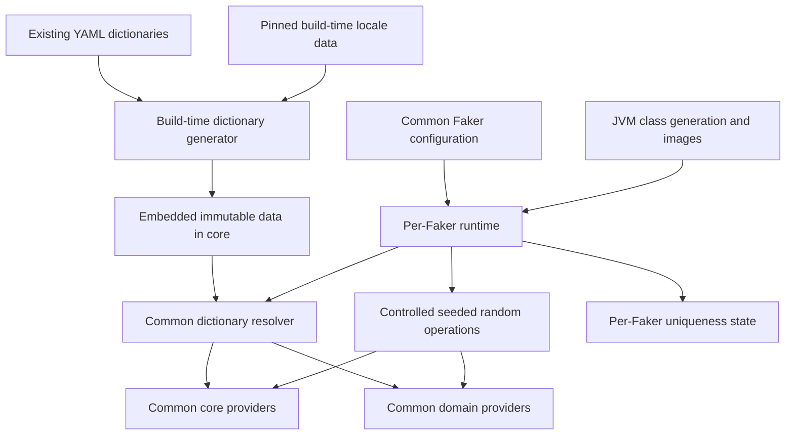

# Kotlin Multiplatform support

Status: ready to begin the ordered implementation plan at Task 1, after a fresh coherence/readiness pass. Feasibility results and later stage-specific API decisions remain explicit prerequisites, not completed evidence. Review dispositions and the fresh-pass fixes are recorded in [review-remediation.md](review-remediation.md).

Issue: [#226](https://github.com/serpro69/kotlin-faker/issues/226). Target: the next major release; no numeric release version is assumed. Companion documents: [implementation](implementation.md), [tasks](tasks.md), [isolated fact-check](verification.md).

## Problem and agreed outcome

Kotlin developers writing shared application and test code need to use Faker from `commonMain`. Today the Gradle plugin is multiplatform, but the implementation and useful published API remain JVM-specific. The migration must provide real executable behavior on JVM, JavaScript, and iOS while retaining the library's dictionaries and familiar provider organization.

The following decisions were explicitly agreed during brainstorming:

| Concern | Requirement |
| --- | --- |
| Platforms | JVM, JavaScript, and iOS in the first release. |
| API | Ordinary core and domain providers, localization, randomness, and uniqueness available in common code. |
| Compatibility | Targeted source and binary breaking changes are acceptable in the next major release. Preserve familiar provider calls where practical. |
| Data | Include every current locale in the normal dependency; no locale opt-in packages. |
| Usage | Preserve synchronous, offline generation. Embedded dictionaries are the preferred representation to investigate, not an already-proven implementation. |
| Determinism | The shared API returns identical results across targets for identical Faker module versions, configuration, seed, inputs, and sequential calls. |
| Time | Time-dependent reproducibility requires identical explicit reference dates/times. |
| Versioning | Seeded output may change between library releases as data and algorithms change. |
| Regex generation | A documented portable syntax must cover every bundled generation pattern. Unsupported syntax fails explicitly; RgxGen syntax parity is not required. |
| JVM features | Arbitrary-class construction and existing JVM image functionality remain JVM-specific. |

Success is observable: an independent consumer resolves released coordinates from `commonMain`, compiles every advertised variant and runs supported providers in the runtime environments specified below, passing shared behavior and seeded-output checks. Merely compiling an empty common artifact does not satisfy the issue.

This is recurring library infrastructure, not a one-off conversion. Contributors must be able to update YAML and add providers without manually maintaining a second set of dictionaries. The measured source tree contains 326 dictionary files in 59 locale groups, totaling 6,451,142 UTF-8 source bytes; English accounts for 1,737,094 bytes and Japanese `address.yml` alone for 2,534,253 bytes. These are source measurements, not predicted package sizes. The repository has 17 domain modules, including the JVM-specific pictures module.

## Evidence and current structure

Inspected baseline: `b5e87c4caeba4ef3813e24b1a03ec669a8eaf3e7`, on 2026-11-23. These are source observations, not claims that the proposed architecture has been tested.

| Existing location | Observation and consequence |
| --- | --- |
| [Kotlin conventions](../../../../buildSrc/src/main/kotlin/faker-kotlin-conventions.gradle.kts) and [JVM conventions](../../../../buildSrc/src/main/kotlin/faker-jvm-conventions.gradle.kts) | KMP plugin already applied; only JVM is declared. JVM libraries and generated JVM resources are currently added through broad source-set configuration. |
| [Core build](../../../../core/build.gradle.kts) and [YAML conversion](../../../../buildSrc/src/main/kotlin/yaml-to-json.gradle.kts) | YAML is converted to JSON using SnakeYAML/Jackson during the build. Runtime core still depends on Jackson, ICU4J, and RgxGen. |
| [FakerService](../../../../core/src/jvmMain/kotlin/io/github/serpro69/kfaker/FakerService.kt) | Classloader streams, `EnumMap`, Java map helpers and Java regex replacement are JVM dependencies. Cross-category expressions already resolve dictionary data rather than reflectively invoking providers. |
| [FakerConfig](../../../../core/src/jvmMain/kotlin/io/github/serpro69/kfaker/FakerConfig.kt), [Faker](../../../../core/src/jvmMain/kotlin/io/github/serpro69/kfaker/Faker.kt), [RandomClassProvider](../../../../core/src/jvmMain/kotlin/io/github/serpro69/kfaker/provider/misc/RandomClassProvider.kt) | Shared configuration and entry point currently expose class-generation configuration and reflection-backed functionality. `RandomProviderConfig` is declared inside `RandomClassProvider.kt`. |
| [Local uniqueness](../../../../core/src/jvmMain/kotlin/io/github/serpro69/kfaker/provider/unique/LocalUniqueDataProvider.kt) and [global configuration](../../../../core/src/jvmMain/kotlin/io/github/serpro69/kfaker/provider/unique/UniqueProviderConfiguration.kt) | `.unique` creates instances and mutates fields through reflection. Global configuration inspects property return types. |
| [RandomService](../../../../core/src/jvmMain/kotlin/io/github/serpro69/kfaker/RandomService.kt), [IRandom](../../../../core/src/jvmMain/kotlin/io/github/serpro69/kfaker/IRandom.kt), [Person](../../../../core/src/jvmMain/kotlin/io/github/serpro69/kfaker/provider/Person.kt) | Public Java date, locale and enum-class types; ICU exemplar characters; JVM UUID conversion; implicit wall-clock reads. |
| [Provider conventions](../../../../buildSrc/src/main/kotlin/faker-provider-conventions.gradle.kts) | Domain modules have a JVM `compileOnly` core dependency. Shared API inheritance requires correct common metadata and transitive core dependencies. |
| [Publishing helper](../../../../buildSrc/src/main/kotlin/utils/Publishing.kt) | The root POM is rewritten to depend on the JVM artifact. Verify this together with Gradle module metadata rather than assuming the rewrite makes KMP resolution invalid. |
| [Integration helper](../../../../test/src/test/kotlin/io/github/serpro69/kfaker/test/helper/IntegrationTestHelper.kt) | Broad provider checks use JVM reflection and JUnit. They do not establish behavior on JS or iOS. |
| [PR workflow](../../../../.github/workflows/pr.yml) | Current checks include `apiCheck`, `check` on three host OSes, CLI native-image checks and MkDocs. Three host OSes do not mean three Kotlin targets. |

All dictionary files, including data used by domain modules, currently live in core. Keep that ownership for this migration. The pictures module uses bundled JPEGs, classloader access and AWT/ImageIO; it has no ordinary dictionary-backed provider to port independently.

Currently `AbstractFaker.fakerService` creates a fresh service on each getter access: providers generally own separate service/dictionary instances but draw from the same configuration's random object. The single-runtime ownership below is a proposed change, not a description of current caching. Some resolver KDoc still describes reflective method dispatch; update it with the migration.

## Architecture

The final architecture has one common implementation of generation behavior. JVM-only functionality remains in JVM source sets and artifacts; platform implementations are limited to genuinely environmental operations, such as obtaining an unseeded source or the current clock.

`AbstractFaker` owns one runtime per Faker instance. That runtime owns its random stream, merged dictionary views and unique-value state. Pure source data can be shared immutably. Provider construction and data-cache loading must not consume randomness or change later generation. Generated-value memoization is separate from dictionary caching and must have explicit call-sequence tests.

Do not share the current mutable category-only `EnumMap` unchanged. Several providers use one primary category with different secondary resource files. Cache decoded source projections by logical source identity and category; cache immutable resolved views by normalized locale, primary category, secondary resource identity and the ordered overlay inputs. A secondary resource name is distinct from an ordinary nested function key or argument. Loading a sibling provider must neither satisfy the wrong cache entry nor mutate another provider's view. Test cold/warm access and reversed sibling construction/loading with the same subsequent generation calls.

Retain existing domain boundaries and coordinates. Move portable implementations to `commonMain`; do not duplicate provider behavior in `jvmMain`, `jsMain` and `iosMain`. Full reflective discovery is unnecessary for dictionary resolution or provider registration. Task 30 explicitly closes the common declarations for `FakerConfig`, `AbstractFaker`, `FakerService`, `IRandom`, `RandomService` and provider bases before Task 27 moves concrete providers. Temporary JVM adapters must be removed or retained solely as JVM convenience APIs, not assumed to become common automatically.

### Embedded dictionaries

Keep existing YAML paths as authoring inputs during the migration so documentation includes and contributor workflows remain usable. Extend or refactor `yaml-to-json` to produce generated common sources under the build directory. Preserve SnakeYAML's handling of anchors and aliases; JVM build tooling may continue using Jackson and ICU4J.

The preferred first candidate is canonical JSON carried in bounded Kotlin string chunks. Resolve YAML anchors/aliases first, then partition locale-wide files into category projections while retaining source-file identity and overlay precedence in a generated index. A name lookup must not deserialize the whole locale-wide object. Generate separate lazy suppliers for these projections rather than a single giant static initializer. Chunk by encoded JVM constant limits as well as source length; split initializer methods/classes as needed. The Japanese address file makes a single-literal implementation unacceptable. Generated files are build outputs, never hand-edited or checked in as a parallel dictionary source.

The common decoder uses the `kotlinx.serialization` JSON tree API, with an internal boundary that keeps JSON types out of public provider signatures. Arrays retain source order. Any operation sampling object values must use an explicit deterministic key order, not map/hash iteration. Preserve scalar distinctions and existing consumed shapes; inventory unexpected types before choosing conversion behavior.

Package every locale and category through embedded data. Decode only data needed by an accessed provider, with dependencies loaded as required by expressions. Lazy decoding is an initialization/memory property, not a promise of tree-shaken download size. No runtime downloads or consumer asset-copy steps are introduced.

At the Task 5 runtime cutover, remove `locales/**` YAML and generated JSON from the **main JVM artifact**; keep the YAML authoring inputs and intentional test fixtures in the repository. Do not ship the old representations beside embedded data. Update the current locale-enumeration test, which reads classpath YAML, to use a generated locale manifest. Treat direct consumer classloader access to these internal resource paths as an explicit major-release packaging break; audit repository consumers before removal. Task 20 narrows the CLI native-image resource configuration after checking its remaining resources, including BLNS JSON and image assets. Removing the broad JSON rule must not strip unrelated required resources.

### Resolution and locale fallback

Preserve default English data, base-locale overlays, exact-locale overlays, category aliases, child categories, nested keys and cross-category references. Normalize underscore/hyphen locale spelling consistently. The precedence is default English, then base locale, then exact locale; preserve the existing category-specific behavior for phone numbers, cell phones, currency symbols and separators using characterization cases.

Replace classloader access with generated lookup by logical resource key. Replace `Matcher`, `StringBuffer`, `toPattern`, `EnumMap` and Java collection helpers with common implementations. Expression parsing must preserve category context for each substitution and must not require the corresponding domain provider class to be installed.

Partial locales remain supported by fallback. An unknown locale or missing required default resource fails with the locale/category/key in the error. Migration must not silently repair or discard dictionary entries to make a target pass; discrepancies are recorded and resolved explicitly. The current resolver accepts one to three key components and documents incomplete third-level localized merging. Task 1 characterizes real inputs and Task 5 records whether affected calls require a scoped fix; this design does not claim existing arbitrary-depth merging.

### Seeded randomness

Faker owns the seeded algorithm and the algorithms that turn random bits into bounded numbers, characters, UUID strings, subsets and shuffles. Calling `kotlin.random.Random(seed)` alone does not meet the agreed library-version contract: Kotlin documents that the sequence may change with its runtime version.

The first candidate is a common implementation of the small reference SplitMix64 generator, with explicit unsigned wraparound, seed initialization and golden vectors. Finalize its sampling rules in the feasibility slice: unbiased bounded integer sampling, fixed floating-point bit conversion, byte ordering and shuffle order. No host numeric formatting or platform RNG is used in seeded generation. Preserve attribution for any reused implementation. This is not a claim that Kotlin's existing seeded factory uses different platform RNGs: inspected Kotlin source uses common XorWow code; the stronger concern is independence from runtime upgrades and derived algorithms.

Configuration stores a seed rather than an already-advanced seeded generator. Every Faker created from the same seeded configuration starts independently at the **same raw random sequence**, including different families such as `Faker` and `BooksFaker`. This can correlate their selections; it does not promise equal final provider values or statistically independent streams. Do not mix seeds with a Faker identifier: callers who need separate streams supply distinct seeds. Document this major-release change from today's shared configuration-owned stream.

A caller-supplied `Random` object remains caller-owned: reusing that object across Fakers deliberately shares its advancing state, and interleaving calls affects output. A configured `randomSeed` continues to take precedence over `random`. Tests and the migration guide must distinguish these two configuration modes. Custom randomness, callbacks, regex exclusions and unordered caller collections require identical observable behavior/initial state or iteration order across targets; Faker cannot impose cross-platform semantics on arbitrary caller implementations.

The contract assumes sequential use of each Faker instance. Concurrent scheduling of calls and unseeded output are not reproducible contracts. Neither generation nor uniqueness becomes a cryptographic or thread-safety feature in this migration.

### Uniqueness

Replace `UniqueProviderDelegate` reflection with explicit typed factories that construct the unique view using the same runtime and intended unique state. Factories capture additional dependencies such as `Internet`'s `Name` or `Finance`'s random service. The unique view must not mark the ordinary provider instance as permanently unique.

Use explicit provider/function identifiers or common instance-based configuration instead of `KProperty.returnType` inspection. Preserve global enable/disable, local `.unique`, clearing, exclusions and retry-limit semantics, with migration documentation for changed configuration calls. Uniqueness state belongs to a Faker instance, never a process-global registry. Existing global configuration is partitioned by provider and function/key; it is not a cross-provider deduplication pool, and local uniqueness takes precedence over global configuration.

Characterize clearing and wrapped-call behavior explicitly: current local/global reset operations differ, and methods that bypass `resolveUniqueValue` are not automatically unique merely because they are called through `.unique`. Do not claim blanket per-method uniqueness without defining and testing it. Source inspection also found exclusion rejection branches that can recurse without checking the retry limit; Task 7 must bound every rejected attempt. Typed factories must fix the existing one-argument clone mismatch for providers with additional constructor arguments.

Keep user-supplied exclusions as Kotlin `Regex` values and retain `containsMatchIn` matching. Their reproducibility condition is that the pattern/options compile and yield the same match decisions on the targets being compared, just as a supplied random source or callback must behave identically. Kotlin explicitly documents platform differences in regex syntax/options and matching; do not promise that arbitrary patterns are portable. Task 7 tests representative portable exclusions and documents this condition. No exclusion DSL, custom matching engine or separate portability gate is required. This decision supersedes the original A7 blocker; it does not relax the separate portable **generation** contract for `regexify`.

### Portable regex generation

Inventory patterns reaching `regexify`, including after provider preprocessing. Real callers include `Address.postcode`, `Bank.ibanDetails`, `Finance.creditCard`, `Vehicle.licencePlateByState`, cryptography strings and public `StringProvider.regexify`.

Start from literals, escaping, character sets/ranges, concatenation, grouping, alternatives and bounded repetition. This is a candidate grammar, not an assertion that it covers the entire corpus. The inventory determines additional required constructs. If unbounded repetition is required, define one documented generation bound and reject malformed or unsupported syntax before consuming random state.

Use the same parser and generation semantics on every target, and validate generated examples with independent matching checks where possible. Do not use a JVM generator and an unrelated JS generator behind `expect/actual`; their random consumption would undermine reproducibility. Do not confuse Kotlin's regex matching facility with a string generator.

Unsupported constructs fail with the pattern position and reason. Full Java/RgxGen regex parity, a general-purpose matching engine and permissive approximation of unsupported assertions are excluded. If the bundled corpus cannot be supported within that boundary, stop and revise the design rather than dropping patterns.

### Locale characters, dates and other JVM types

Locale-aware random strings must keep working for bundled locales. Prefer generating the required ICU exemplar character tables at build time from a pinned data version, retaining the main/auxiliary/index/punctuation options. Enumerate the existing behavior for locale tags beyond bundled dictionaries before choosing a support boundary; any lost accepted input needs an explicit migration decision. No silent ASCII fallback is permitted.

The proposed date family is `kotlinx.datetime.LocalDate` for birth dates and common instants for random timestamps. Use explicit reference times and UTC/fixed offsets for deterministic generation. Do not replace `OffsetDateTime` with a local datetime that silently loses its offset; finalize the return shape and JVM conversion helpers in Task 11. Named timezone-database behavior is not needed by the existing fixed-offset API.

Keep UUID output as a string, with a documented UUID algorithm and common formatting. The existing implementation mixes random version bits with a name-based UUID conversion; do not accidentally treat that as a v4 compatibility requirement. Choose and document the major-release behavior in Task 10.

Use reified/explicit enum values in common APIs; retain Java `Class<E>` convenience only in JVM code. Audit string preparation, Unicode casing, regex character classes and formatting for platform-dependent behavior. Invariant ASCII operations and explicit existing transliteration tables should replace host-locale assumptions where applicable.

### JVM-only entry points and dependent modules

Keep `RandomClassProvider`, its configuration/parameter inspection, `FakerExt` class-generation helpers and Java `FunctionalUtil` in JVM source sets. Remove their types from shared configuration and the common `Faker` surface. Provide a clearly named JVM factory/facade for configuring class generation; do not introduce a common method that throws on JS/iOS. Exact JVM facade names are an implementation-level API decision tracked in Task 9.

Pictures retain their current JVM artifact and behavior. Existing BLNS and Kotest extensions retain JVM compatibility; porting those separate extension APIs is not required to close the core KMP issue. Validate them against the migrated core rather than leaving stale dependencies. This is a proposed scope interpretation of ordinary providers, identified here for review.

## Build, publication and supported environments

Use the existing convention-plugin structure. Portable modules declare JVM, JS (browser and Node test environments), `iosArm64` and `iosSimulatorArm64`. An Intel simulator artifact is conditional on the selected Kotlin toolchain still supporting it; this does not justify adding desktop Native or Wasm targets. Android/JVM consumers remain covered through the JVM artifact; a new Android-specific library artifact is unnecessary unless resolution tests demonstrate a need.

Use this verification matrix consistently; “all targets” in task verification means these applicable compile and execution checks, not running an iOS device binary directly on a Mac:

| Variant/environment | Required evidence |
| --- | --- |
| JVM | Compile and run shared/provider/consumer cases on the supported minimum and maximum JDKs. |
| JS browser and Node | Compile and run the shared/provider/consumer cases in both environments. |
| iOS simulator Arm64 | Compile, link and run shared/provider/consumer cases on the selected Mac/Xcode simulator runtime. |
| iOS device Arm64 | Compile the library and compile/link the representative consumer; physical-device installation/execution is not required for this shared-library migration. |
| Optional Intel simulator | Task 1 decides whether to advertise it and records its matching build/test host; do not claim its runtime tests passed without that runner. |

Actual device-only behavior, if later introduced, requires matching execution evidence rather than relying on the shared-library assumption. No such device-only feature is planned here.

Task 26 applies the validated producer/dependency tuple to the real catalog, wrapper and build conventions and enables production core JVM, JS browser/Node and iOS compile/test targets **before Task 5 introduces shared production behavior**. Task 31 installs their required PR jobs, the chosen coverage measurement and publication guard before extraction begins. Keep the public `Faker` facade in `jvmMain` until Task 13. Each extracted common component has a closed common dependency graph: pass locale/configuration values and a common random-operation interface into it; JVM adapters call that implementation. No common component may reach back into the legacy JVM `FakerConfig`, `FakerService`, `IRandom` or provider classes. Subsequent tasks port these facades only once their dependencies are common.

Add generated common sources through declared task outputs/dependencies. Scope JDK libraries, kotlin-reflect and JUnit/Kotest JVM runner dependencies to JVM source sets. Remove legacy locale resource packaging at Task 5 rather than merely moving its source-set registration. Domain modules expose core as a common API dependency because their public classes inherit core types. Task 29 prepares the shared opt-in domain convention before parallel domain migrations: reuse the established portable targets/tests, use common `api(core)`, and keep the existing `:test`/`testHelper` JVM test JAR in `jvmTest` only. Each domain task opts its own module in; pictures and extensions retain their JVM convention. Preserve independently versioned module compatibility in published metadata and BOM checks.

Compilation/test enablement is separate from publication readiness. Task 31 blocks remote migration publication, including dependent JVM modules and the BOM, while allowing project-local staging. The guard covers direct Maven uploads, NMCP aggregate upload tasks, `publishToAppropriateCentralRepository` and tagging/release entry points; guarding only the wrapper task cannot prevent its dependencies from uploading. A skipped publication must not permit a release tag to be created.

Task 21 proves the graph and Task 22 prepares the publisher, but neither opens the remote gate. It stays closed until final verification/documentation in Task 24 is complete and a separate release action is authorized. Every production slice from Task 5 onward tests the **actual changed common sources** on JVM, JS and an iOS simulator, enforced by the Task 31 jobs. Task 30 closes common runtime declarations, Tasks 27/28 close concrete providers, Task 13 exposes the facade and Task 29 verifies actual core artifact consumption before domain migration.

Publish root KMP metadata and every advertised target artifact. Retain the current root-POM JVM redirect only if independent Gradle/KMP and Maven/JVM fixtures prove both paths work; otherwise use standard KMP root metadata and document explicit JVM coordinates for Maven consumers. A local repository test must use coordinates without project substitution. No remote release is part of the feasibility work.

Mac runners execute iOS simulator binaries. Use one macOS publishing job (`macos-latest`, with the supported Xcode/runner combination validated and recorded in Task 1) for root, JVM, JS, iOS and BOM publications. Task 22 replaces the current Ubuntu root/JVM publication matrix with this single publisher. Linux/Windows remain verification hosts, not additional publishers of those coordinates. This avoids depending on version-sensitive Linux-to-Apple cross-compilation and prevents duplicate root/BOM uploads. Keep current JVM minimum/maximum, CLI and signing checks; host-only JVM runs cannot count as target coverage.

### Shared test execution

Use **`kotlin.test` annotations and assertions in `commonTest`**, with the version aligned to the selected Kotlin toolchain. Configure its JVM JUnit 5 integration alongside the existing Kotest/JUnit engine, and use KGP's JS and Native test execution. Task 1 verifies discovery/execution of at least one common test on each target; Task 26 installs that setup in production and Task 31 makes the jobs and chosen coverage check required before new production behavior is added. No Kotest multiplatform compiler plugin or KSP test generator is introduced.

Existing Kotest `DescribeSpec` and reflection-based integration suites stay in `jvmTest`. Add ordinary type-checked common tests for migrated behavior and selectively move reusable fixtures/assertion logic; do not mechanically move DescribeSpec classes into `commonTest` or require a wholesale rewrite of unrelated JVM specs. Test evidence must show the common cases actually ran, not merely that compilation or a zero-test task succeeded.

## Dependency decisions and evidence limits

Existing baseline: Kotlin 2.1.21, Gradle 8.14.3, JVM runtime target 11, compiler JDK 21. Kotlin's compatibility table places 2.1.20–2.1.21's fully supported Gradle range at 7.6.3–8.12.1; the current wrapper is outside that guarantee, not proven broken. Use `$kk:dependency-handling` before pinning or changing versions.

The JSON tree API was checked against serialization 1.11.0 documentation; that release is built against Kotlin 2.3.20, which is not by itself a declared minimum consumer compiler version. Date APIs were checked against datetime 0.8.0 documentation, which declares Kotlin stdlib 2.1.20 or newer. Its instant type is `kotlin.time.Instant` (experimental in Kotlin 2.1.21), and it has no direct `OffsetDateTime` value-type replacement. Those checks establish candidate capabilities, not compatibility with the current build. Task 1 selects and records a supported Kotlin/Gradle/plugin/library tuple, preferring stable releases and limiting upgrades to what this migration requires. No version pin in the current repository was changed during design.

Task 1 must also choose explicit **minimum consumer Kotlin versions for JVM and KMP**, resolving stdlib/dependency requirements and any language/API settings. The producer compiler version alone does not determine one universal consumer floor: JVM metadata and JS/Native klib compatibility differ. Prefer the lowest practical documented consumer floor compatible with the chosen features; record a required increase as a major-release migration cost. Tasks 4, 29 and 21 compile consumers with those declared floors, with Task 29/21 using real production artifacts. Do not infer support from a producer build or a fixture that silently upgrades its consumer compiler. Publish the tested compiler/stdlib/platform requirements in Task 23.

Avoid a serialization compiler plugin solely for parsing JSON trees. Avoid adding KSP solely to replace explicit provider factories. ICU4J may remain a build-time data source even after its runtime removal. Choose a regex dependency only after verifying its targets, syntax, failure behavior and controllable randomness; no suitable replacement is asserted by this document.

## Feasibility milestone and acceptance

Limit pre-production investigation to the uncertain mechanisms. Task 1 inventories inputs and selects the trial toolchain/test and consumer-version matrix. Task 2 compiles and lazily decodes the **full dictionary payload** without a provider/resolver implementation. Task 25 checks the seeded generator/sampling independently. Task 3 checks the corpus-driven regex grammar/generator using that stream. Task 4 publishes one minimal probe artifact and consumes it externally; it does not emulate a core/domain module graph or prove the repository's production publishing hooks.

The fixture under `test/fixtures/kmp-feasibility/` contains no copied Faker facade, address fallback, cross-category resolver, books provider or uniqueness subsystem. Those behaviors are tested directly in production after Task 26 enables targets. Candidate data/random/regex components may be promoted into production once, retiring their superseded fixture copies; do not maintain a second implementation. Keep the standalone probe outside root project includes, the BOM and release aggregation, using separate local-only coordinates. Its public probe entry points and test/build scaffolding never enter production source roots or artifacts. Promote only internal mechanism code/generated data; Task 29 checks packaged/public surfaces for probe leakage. The external consumer harness can later consume actual artifacts in Tasks 29 and 21.

Record toolchain/test versions, declared consumer floors, commands, artifact sizes, lazy payload decoding and compile/resource costs. There is no agreed numeric performance SLA. Hard failures are compiler/constant limits, missing data, eager decoding of all locales, required network/asset setup, target incompatibility, seeded mismatches or a need to raise CI capacity without an explicit design revision. Provider initialization/fallback/uniqueness measurements belong to production Tasks 5–13. Prototype publication proves only the basic KMP artifact/dependency mechanism; root-POM rewriting, signing and the real module graph are verified against production artifacts.

The production release requires:

1. All in-scope providers callable from common code, with target variants and complete locale data.
2. Shared tests for fallback, nested/cross-category expressions, supported regex syntax, fail-loud rejection, uniqueness/exhaustion/clearing, deterministic utilities and explicit-time operations.
3. Equal seeded reference vectors on each target, plus independent semantic invariants so identical wrong results do not pass.
4. Separate consumer tests for KMP coordinates, domain-to-core dependencies, JVM Kotlin/Java, Maven/BOM and existing JVM integrations.
5. Required repository/release checks, coverage evidence for new code, supported-target CI and a migration guide naming every API break and platform boundary.

## Assumptions and unresolved gates

| ID | Testable assumption or open decision | Owner task / consequence |
| --- | --- | --- |
| A1 | Chunked embedded data fits compiler and existing CI resource limits with all locales. | Tasks 2 and 4; change representation if it fails, not locale scope. |
| A2 | Bundled regex patterns admit a bounded portable grammar. | Tasks 1 and 3; record exact grammar before production migration. |
| A3 | Pinned locale character data and common text operations can meet deterministic behavior for supported inputs. | Tasks 1 and 12; document any proposed accepted-input change before adoption. |
| A4 | The chosen toolchain/test tuple supports declared consumer Kotlin floors and real publishing/API tooling. | Tasks 1/4 probe; Tasks 26/29/21 verify actual production configuration. |
| A5 | JVM/JS/iOS means Kotlin consumers through common metadata, not independent npm or Swift SDKs. | Adopted interpretation of #226's commonMain request; independent export products change scope. |
| A6 | Browser/Node and physical/simulator iOS are the intended environments. | Tasks 1 and 4 validate declared target availability and simulator execution. |
| A7 | Caller regex exclusions have equivalent matching behavior on compared targets. | Documented input condition, not a release-blocking engine question; Task 7 retains common Regex and tests portable examples. |
| A8 | Existing extension modules remain JVM-only while core/domain providers become common. | Adopted scope boundary; Task 20 proves existing JVM integration. |
| A9 | Date return shape and JVM facade can be clear breaking APIs without compatibility scaffolding. | Tasks 9 and 11 record signatures and migration entries before moving callers. |

Readiness is staged: Task 1 can begin now. Tasks 2/25/3/4 establish feasibility; only their successful exit permits production setup and extraction. Tasks 9/10/11/12 record exact changed JVM/UUID/date/locale API decisions before changing their callers. Task 30 requires those contracts to be closed, and Task 29 requires actual artifact-consumer evidence before broad domain migration. These are execution gates with owners and observable outcomes, not reasons to repeat the entire design interview. No feasibility build or prototype was run during documentation review.

## Alternatives and rationale

This is a non-trivial migration with real data-distribution and API trade-offs. The user's agreed scope favors synchronous, offline behavior and complete locale availability.

| Direction | Benefit | Cost / disposition |
| --- | --- | --- |
| Embedded generated JSON with a common decoder | One runtime path; offline, synchronous operation; reuses current YAML-to-JSON pipeline. | Preferred candidate. Must prove compiler limits, package size and lazy decoding. |
| Platform resource loaders behind a common interface | Retains files as resources; could reduce generated source. | Fallback if embedding fails. Browser loading/setup and per-target packaging complicate the agreed usage contract. Not yet experimentally rejected. |
| Generated Kotlin object tables | Removes runtime JSON decoding. | Candidate fallback. More generated code/object initialization may increase compile and binary costs; measure before selecting. |

### Rejected alternatives

- English-only or locale opt-in packages: explicitly rejected by the user; all locales remain included.
- Full feature parity before shipping: arbitrary-class construction and JVM image processing are intentionally JVM-specific initially.
- Full RgxGen syntax parity: rejected in favor of a documented portable subset covering shipped patterns.
- Platform-specific seeded generation algorithms: conflict with the agreed cross-platform output contract.
- Strict preservation of old JVM APIs: unnecessary for the agreed major release; would constrain common signatures and feature separation.

### Not Doing

- Desktop Native, Wasm, watchOS and tvOS targets: outside the agreed first-release platforms.
- Multiplatform arbitrary-class construction or image decoding: separate feature designs, not prerequisites for common providers.
- Locale splitting, remote dictionary services or asynchronous consumer setup: conflict with the chosen packaging/usage direction.
- Full regex-engine compatibility: unnecessary for the agreed supported syntax.
- npm packaging, JavaScript/TypeScript exports or a Swift-native SDK: this design targets Kotlin common-code consumers; A5 flags the interpretation.
- New thread-safety, cryptographic randomness or cross-release seeded stability guarantees: unrelated contracts.
- Broad provider/data cleanup: fix only migration-related failures; record other findings without silently expanding scope.

## Sources

- [Issue #226](https://github.com/serpro69/kotlin-faker/issues/226) and [KMP discussion #235](https://github.com/serpro69/kotlin-faker/discussions/235): original request and previous build migration.
- [Kotlin KMP publication structure](https://kotlinlang.org/docs/multiplatform/multiplatform-publish-lib-setup.html): root and target publications and Apple execution requirements.
- [Kotlin seeded Random contract](https://kotlinlang.org/api/core/kotlin-stdlib/kotlin.random/-random.html): runtime-version limitation motivating controlled seeded behavior.
- [Serialization 1.11.0 JSON tree documentation](https://github.com/Kotlin/kotlinx.serialization/blob/v1.11.0/docs/json.md) and [release notes](https://github.com/Kotlin/kotlinx.serialization/blob/v1.11.0/CHANGELOG.md): candidate JSON API and Kotlin baseline.
- [Datetime 0.8.0 documentation](https://github.com/Kotlin/kotlinx-datetime/blob/v0.8.0/README.md): common date/instant conversion capabilities; exact release tuple remains to be validated.
- [SplitMix reference](https://prng.di.unimi.it/splitmix.c): candidate fixed seeded generator; validate the complete sampling layer separately.
- [RgxGen](https://github.com/curious-odd-man/RgxGen): existing Java dependency and its documented generation syntax.
- [Common tests](https://kotlinlang.org/docs/multiplatform/multiplatform-run-tests.html), [Kotlin binary compatibility](https://kotlinlang.org/docs/kotlin-evolution-principles.html#evolving-the-binary-format) and [Regex platform differences](https://kotlinlang.org/api/core/kotlin-stdlib/kotlin.text/-regex/): sources for the review corrections.
